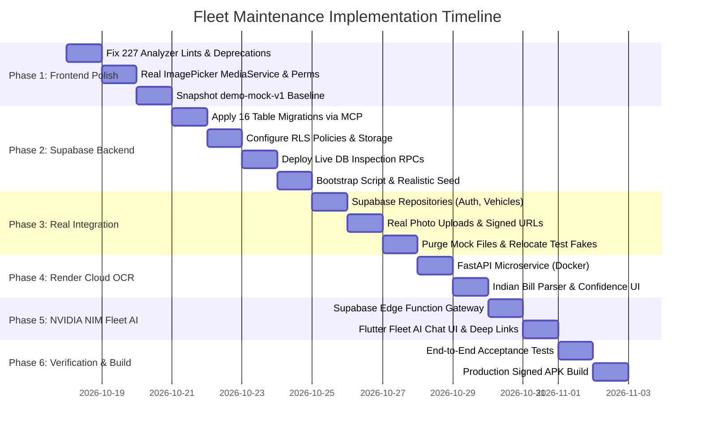

# Master Implementation Plan: Fleet Maintenance & Real-Time Fleet Intelligence System

> **Architecture update (17 October 2026):** Fleet AI is implemented as an authenticated route on the existing Render FastAPI service, alongside OCR. The Render Blueprint provisions private Render Key Value (Redis-compatible) for backend caching. This replaces the original `fleet-assistant` Supabase Edge Function deployment instructions below; deploy only `manage-user` and `bootstrap-company` as Supabase Edge Functions. The change keeps Redis access within Render's private network and avoids a separate Redis provider.

## 1. Executive Blueprint & Current System State

This document is the definitive master implementation plan for building, connecting, and verifying the entire Fleet Maintenance mobile application and backend ecosystem. It eliminates all mock data, placeholder assets, and fake delays, delivering a verified, real working system.

### Verified Current System Baseline
- **Mobile Client**: Flutter (Material 3, Dart null-safe) with 12 core screens built across `lib/features/`.
- **Analyzer & Test Status**: 53 unit/widget/layer-boundary tests passing. 227 analyzer deprecation/lint warnings identified (primarily `withOpacity` $\rightarrow$ `withValues` from Flutter 3.27+ and `const` optimizations), zero fatal compiler errors.
- **Backend Infrastructure**: Supabase Project `uwvjvlkkcknwiapvrwng` (`ap-southeast-1`, PostgreSQL 17 GA) verified and actively managed via Supabase MCP.
- **Mobile Cloud Link**: Firebase Project `busapp-3a05a` (`com.fleetpulse.bus_app`) configured. `google-services.json` placed in `android/app/` and Google Services Gradle plugins registered in `android/settings.gradle.kts` and `android/app/build.gradle.kts`.
- **Agent Tooling**: Official Supabase skills installed in `.agents/skills/` (`supabase`, `supabase-postgres-best-practices`).

---

## 2. System Architecture & Component Topology

```
┌─────────────────────────────────────────────────────────────────────────────┐
│                          FLUTTER MOBILE CLIENT (Android / iOS)              │
│                                                                             │
│  Presentation Layer: Screens, Widgets, Notifiers, GoRouter (Role-Guarded)   │
│  Domain Layer: Immutable Models, Repository Interfaces, Services            │
│  Data Layer: Supabase Data Repositories, Secure Storage, Native Camera/OCR  │
└───────────────┬────────────────────────────┬─────────────────────────┬──────┘
                │ (HTTPS / Realtime)         │ (Multipart Upload)      │ (POST /ocr)
                ▼                            ▼                         ▼
┌───────────────────────────────┐ ┌────────────────────┐ ┌────────────────────┐
│   SUPABASE POSTGRESQL 17      │ │  SUPABASE STORAGE  │ │  RENDER CLOUD OCR  │
│                               │ │  (Private Buckets) │ │   (FastAPI Free)   │
│  - 16 Relational Tables       │ │  - vehicle-photos  │ │  - Indian Bill     │
│  - Multi-Tenant RLS           │ │  - service-photos  │ │    Regex & Parsing │
│  - Automated Triggers         │ │  - bills           │ │  - GSTIN, Date,    │
│  - Live DB Inspection RPCs    │ │  - avatars         │ │    Vendor, Totals  │
└───────────────▲───────────────┘ └────────────────────┘ └────────────────────┘
                │
                │ (Internal RPC / SQL Execution under User JWT)
                │
┌───────────────┴─────────────────────────────────────────────────────────────┐
│        SUPABASE EDGE FUNCTION: fleet-assistant (NVIDIA NIM Gateway)          │
│                                                                             │
│  1. Authenticates User JWT & Company Isolation Context                      │
│  2. Invocates NVIDIA NIM API (https://integrate.api.nvidia.com/v1)          │
│  3. Model: meta/llama-3.3-70b-instruct via Tool / Function Calling          │
│  4. Executes Live DB Inspection RPCs for 100% Deterministic Ground Truth     │
│  5. Returns Real-Time Structured Fleet Answers to Mobile Chat Interface     │
└─────────────────────────────────────────────────────────────────────────────┘
```

---

## 3. 100% Accurate Real-Time Fleet AI Architecture (NVIDIA NIM)

To guarantee **100% factual accuracy** with **zero hallucination**, the AI does not rely on static semantic retrieval for operational status. Instead, it uses **NVIDIA NIM Tool/Function Calling** directly into PostgreSQL RPC functions.

### Architecture Components
1. **Model Endpoint**: NVIDIA NIM API (`https://integrate.api.nvidia.com/v1`) using `meta/llama-3.3-70b-instruct` or `meta/llama-3.1-70b-instruct`.
2. **Serverless Secure Gateway**: Supabase Edge Function `fleet-assistant`. The `nvapi-...` key is stored exclusively in Supabase secrets, never shipped to the client app.
3. **Live Database Inspection RPC Tools**:
   - `rpc_get_fleet_summary()`: Live count of total buses, active vehicles, buses in workshop, overdue tasks, and tasks due in $\le 14$ days.
   - `rpc_query_vehicle_status(reg_no_or_id)`: Exact live odometer, depot, driver, last service date, next scheduled service date/km.
   - `rpc_get_due_maintenance(days_ahead)`: Exact maintenance tasks due within $N$ days or $N$ km, categorized by Overdue, Due Soon, and On Track.
   - `rpc_get_expiring_documents(within_days)`: Insurance, Fitness Certificates, State Permits, and PUC records expiring within $N$ days.
   - `rpc_get_cost_breakdown(start_date, end_date, vehicle_id)`: Itemized expenditure on parts, labour, and taxes directly from service records.
4. **Deterministic System Grounding**:
   The system prompt forces the model to respond solely using the JSON payloads returned by the database RPC tools. If a bus registration or record is absent, it responds that the record does not exist in the company fleet.
5. **Flutter Mobile UI (`/fleet-ai`)**:
   - Dedicated Chat Interface with streaming Markdown output.
   - Suggested query chips: *"Which buses are overdue for service?"*, *"Show fitness certificates expiring this month"*, *"Total workshop spend last 30 days"*, *"Status of TS 09 UB 4521"*.
   - Rich interactive cards embedded in chat messages (e.g., Vehicle Card, Task Card) with direct deep-links into `VehicleDetailScreen` and `ServiceDetailScreen`.

---

## 4. Render Cloud OCR Microservice Specification

Hosted as a free-tier containerized FastAPI service on Render:
- **Repository Location**: `backend/ocr_service/`.
- **Endpoint**: `POST /ocr/scan-bill` (Accepts multipart image file).
- **Core Engine**: Python OCR (Tesseract / PaddleOCR / EasyOCR) coupled with deterministic Indian invoice field extraction:
  - **GSTIN**: `[0-9]{2}[A-Z]{5}[0-9]{4}[A-Z]{1}[1-9A-Z]{1}Z[0-9A-Z]{1}`
  - **Invoice Number**: Keyed from prefixes `INV-`, `Bill No`, `Invoice No`, `Cash Memo`.
  - **Invoice Date**: Keyed from `dd/MM/yyyy`, `dd-MM-yyyy`, `dd MMM yyyy`.
  - **Amounts**: Itemized parts rows, subtotal, GST percentage/amount (5%, 12%, 18%, 28%), and Grand Total.
- **Client Integration**: Placed behind the existing Flutter [OcrService](file:///c:/Users/karth/Documents/desktop/Bus/lib/features/bills/domain/ocr_service.dart) interface. Low-confidence fields ($< 0.85$) are visually flagged with an amber *"Check this"* warning for user confirmation before saving.

---

## 5. PostgreSQL Schema & Migrations Specification (Supabase)

All 16 tables carry `company_id`, `created_at`, `updated_at`, and `created_by` to enforce zero-trust isolation.

### Table Schema Matrix
1. **`companies`**: `id uuid PK`, `name text`, `logo_url text`, `default_reminder_lead_days int default 14`, timestamps.
2. **`profiles`**: `id uuid PK references auth.users`, `company_id uuid references companies`, `name text`, `email text`, `phone text`, `role text check (role in ('admin', 'staff'))`, `status text check (status in ('active', 'disabled'))`, `avatar_url text`.
3. **`vehicles`**: `id uuid PK`, `company_id uuid`, `registration_no text unique`, `make text`, `model text`, `year int`, `chassis_no text`, `engine_no text`, `seats int`, `fuel_type text`, `odometer_km int`, `depot text`, `purchase_date date`, `status text check (status in ('active', 'due_soon', 'overdue', 'in_workshop'))`, `deleted_at timestamptz`.
4. **`vehicle_documents`**: `id uuid PK`, `company_id uuid`, `vehicle_id uuid references vehicles`, `type text check (type in ('insurance', 'fitness', 'permit', 'puc'))`, `number text`, `expiry_date date`, `file_url text`.
5. **`vehicle_photos`**: `id uuid PK`, `company_id uuid`, `vehicle_id uuid references vehicles`, `url text`, `caption text`.
6. **`service_schedules`**: `id uuid PK`, `company_id uuid`, `vehicle_id uuid references vehicles`, `task_name text`, `interval_km int`, `interval_months int`, `last_done_date date`, `last_done_km int`.
7. **`maintenance_tasks`**: `id uuid PK`, `company_id uuid`, `vehicle_id uuid references vehicles`, `schedule_id uuid references service_schedules`, `service_record_id uuid`, `title text`, `due_date date`, `due_km int`, `is_done boolean default false`, `completed_at timestamptz`, `completed_by uuid references profiles`.
8. **`service_records`**: `id uuid PK`, `company_id uuid`, `vehicle_id uuid references vehicles`, `type text`, `date date`, `odometer_km int`, `workshop text`, `mechanic text`, `notes text`, `labour_cost numeric(12,2) default 0.00`, `tax numeric(12,2) default 0.00`, `total numeric(12,2) not null`.
9. **`service_parts`**: `id uuid PK`, `company_id uuid`, `service_record_id uuid references service_records on delete cascade`, `name text`, `qty numeric(10,2)`, `cost numeric(12,2)`.
10. **`service_photos`**: `id uuid PK`, `company_id uuid`, `service_record_id uuid references service_records on delete cascade`, `url text`, `type text check (type in ('before', 'after', 'part', 'bill'))`, `caption text`, `part_id uuid references service_parts`.
11. **`bills`**: `id uuid PK`, `company_id uuid`, `vehicle_id uuid references vehicles`, `service_id uuid references service_records`, `vendor text`, `bill_no text`, `bill_date date`, `tax numeric(12,2)`, `total numeric(12,2)`, `image_url text`, `ocr_confidence numeric(4,3)`.
12. **`bill_items`**: `id uuid PK`, `company_id uuid`, `bill_id uuid references bills on delete cascade`, `name text`, `qty numeric(10,2)`, `cost numeric(12,2)`.
13. **`notifications`**: `id uuid PK`, `company_id uuid`, `user_id uuid references profiles`, `type text`, `title text`, `body text`, `link_target text`, `read_at timestamptz`.
14. **`user_settings`**: `user_id uuid PK references profiles`, `theme_mode text default 'system'`, `distance_unit text default 'km'`, `currency text default 'INR'`, `date_format text default 'dd MMM yyyy'`, `service_reminders_enabled boolean default true`, `service_reminders_lead_days int default 14`, `doc_expiry_reminders_enabled boolean default true`, `doc_expiry_reminders_lead_days int default 15`.
15. **`company_settings`**: `company_id uuid PK references companies`, `default_reminder_lead_days int default 14`.
16. **`audit_log`**: `id uuid PK`, `company_id uuid`, `user_id uuid references profiles`, `action text`, `resource_type text`, `resource_id text`, `details jsonb`, `created_at timestamptz default now()`.

### Database Triggers & Functions
1. **`trg_service_record_completed`**: When a `service_record` is inserted:
   - Updates the matching `service_schedules` (`last_done_date = NEW.date`, `last_done_km = NEW.odometer_km`).
   - Automatically closes any matching open `maintenance_tasks` (`is_done = true`, `completed_at = now()`, `service_record_id = NEW.id`).
2. **`trg_soft_delete_vehicle`**: Intercepts `DELETE on vehicles`, sets `deleted_at = now()`, and logs to `audit_log`.

### Row Level Security (RLS) Policy Rules
- **Multi-Tenant Filter**: Every table enforces `company_id = (SELECT company_id FROM profiles WHERE id = auth.uid())`.
- **Role Permissions**:
  - `admin`: Full `SELECT`, `INSERT`, `UPDATE`, `DELETE` on all business tables and user management.
  - `staff`: Permitted to `SELECT` fleet records, `INSERT` service records, service parts, and photos, and update task status (`setTaskDone`). Strictly blocked from `DELETE` on vehicles, modifying users, or altering company settings.

---

## 6. Phase-by-Phase Roadmap to Final Delivery



### Phase 1: Frontend Polish & Real Media Capture
- Fix all 227 `flutter analyze` linter & deprecation issues (`withOpacity` $\rightarrow$ `withValues`, `const`, unused imports).
- Add `image_picker: ^1.1.2` and implement `ImagePickerMediaService` in `lib/core/services/media_service.dart`.
- Verify camera capture, gallery selection, multi-pick, and local compression (~1600px, 80% JPEG).
- Confirm Android camera/storage permissions in `AndroidManifest.xml` and iOS permissions in `Info.plist`.
- Run `flutter analyze` and `flutter test` (100% green).
- Tag git commit `demo-mock-v1`.

### Phase 2: Supabase Backend Deployment (via Supabase MCP)
- Create versioned migrations in `supabase/migrations/` and apply them directly to project `uwvjvlkkcknwiapvrwng` using `apply_migration` / `execute_sql`.
- Create all 16 tables, foreign keys, and indexes.
- Enable RLS on every table and create policies for company isolation and admin/staff roles.
- Create private storage buckets (`vehicle-photos`, `service-photos`, `bills`, `avatars`) with access policies.
- Create live DB inspection RPCs: `rpc_get_fleet_summary`, `rpc_query_vehicle_status`, `rpc_get_due_maintenance`, `rpc_get_expiring_documents`, `rpc_get_cost_breakdown`.
- Deploy `bootstrap-company` function to initialize the primary admin and company.
- Execute development/staging seed script populating the 10 realistic Indian buses and history.

### Phase 3: Connect Frontend to Supabase & Purge Mock Data
- Add `supabase_flutter: ^2.8.0` and `flutter_secure_storage: ^9.2.2` to `pubspec.yaml`.
- Initialize Supabase client in `lib/main.dart` using `--dart-define` config (`SUPABASE_URL`, `SUPABASE_ANON_KEY`).
- Implement real repository classes in each feature's `data/` folder:
  - `SupabaseAuthRepository`: Real login, logout, password change, persistent session via `flutter_secure_storage`.
  - `SupabaseVehicleRepository`: Full CRUD, soft delete, and photo association.
  - `SupabaseServiceRepository`: Service records, line-item parts, photo attachments, and task advancement.
  - `SupabaseBillRepository`: Real bill persistence.
  - `SupabaseUserRepository`: Admin-gated user management.
  - `SupabaseSettingsRepository`: Database persistence for user and company preferences.
- Implement real photo upload pipeline to Supabase Storage with signed URL generation.
- Purge `lib/mock/`, delete `assets/mock/` from `pubspec.yaml`, and remove demo credentials from `login_screen.dart`.
- Move mock repositories to `test/fakes/` so offline widget and unit tests continue passing in CI.

### Phase 4: Render Cloud OCR Microservice
- Build containerized Python FastAPI service in `backend/ocr_service/`.
- Implement regex parsers for GSTIN, invoice numbers, dates, line items, and grand totals.
- Deploy to Render Free Tier and provide public HTTPS endpoint.
- Implement `RenderCloudOcrService` in Flutter implementing `OcrService`.
- Wire into the 4-step `AddServiceScreen` stepper with visual confidence indicators.

### Phase 5: Real-Time Fleet AI Assistant (NVIDIA NIM)
- Deploy Supabase Edge Function `fleet-assistant` integrating NVIDIA NIM API (`meta/llama-3.3-70b-instruct`).
- Configure tool calling linking LLM decisions to PostgreSQL RPC functions under user JWT context.
- Create Flutter Chatbot Screen (`lib/features/chat/presentation/fleet_ai_screen.dart`):
  - Conversational UI with markdown rendering and live query suggestions.
  - Interactive vehicle and maintenance task cards embedded directly into chat messages.
- Register route `/fleet-ai` in `app_router.dart` and add navigation entry to `app_drawer.dart`.

### Phase 6: End-to-End Verification & Working APK Delivery
- Execute 10-step manual and automated acceptance test flow (`docs/ACCEPTANCE_TEST.md`).
- Verify live auth, vehicle creation, photo capture/upload, service logging, and OCR scan.
- Verify NVIDIA NIM chatbot answers queries with 100% live database precision.
- Run `flutter analyze` (0 issues) and `flutter test` (all green).
- Build production signed Android APK: `flutter build apk --release`.

---

## 7. Human Checklist (`HUMAN_TASKS.md`)

| Item | Requirement | Status | Action Needed |
|---|---|---|---|
| 1 | **Supabase Project** | Completed | Project `uwvjvlkkcknwiapvrwng` connected |
| 2 | **Firebase Project** | Completed | `google-services.json` placed, Gradle plugins configured |
| 3 | **NVIDIA NIM API Key** | Pending | Get free API key (`nvapi-...`) from [build.nvidia.com](https://build.nvidia.com/) |
| 4 | **Render Account** | Ready for Phase 4 | Free account at [render.com](https://render.com/) to host OCR container |
