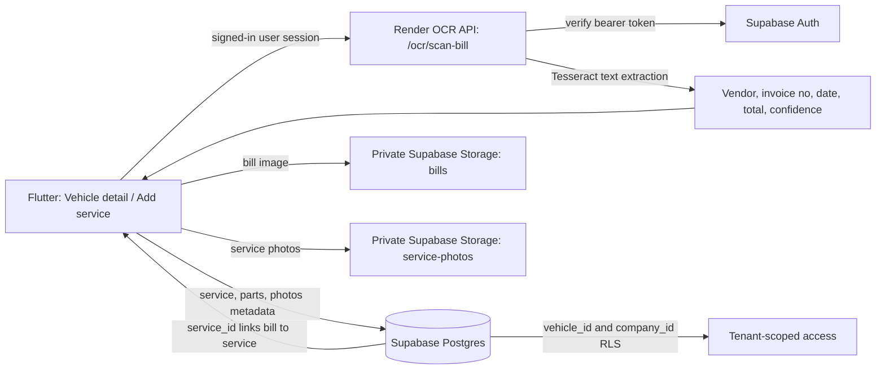

# Vehicle service record workflow

Updated 17 October 2026.

## How to add a service record

1. Open **Vehicles** and select the bus.
2. Open **Service history** and tap **Add service record**. The bus is already selected.
3. In **Details**, enter the service type, date, odometer, workshop/vendor, mechanic and work performed/findings.
4. In **Parts**, add each replaced part and its quantity and unit cost. Enter labour. The app shows its estimated total (including the current 18% tax calculation).
5. In **Photos**, attach before, after and replaced-part images as available.
6. In **Bill & Save**, take a bill photo or choose one from the gallery. The app sends the image to the authenticated Render OCR endpoint, shows the extracted vendor, bill number, date and total, and lets the user review/edit the fields.
7. Tap **Review & Save**. The service record, parts and service photos are saved to Supabase. If a bill image or bill fields were supplied, the invoice image and OCR fields are saved as a bill linked to that service and vehicle. The manually entered replacement parts are also copied to the bill item list.

## Data and connection architecture

### Tables and storage

| Information | Supabase location |
| --- | --- |
| Service visit: vehicle, type, date, odometer, workshop, mechanic, notes, labour, tax and total | `service_records` |
| Replaced parts: name, quantity and cost | `service_parts` |
| Before/after/part photos and captions | `service_photos`; original image files in private `service-photos` bucket |
| Invoice vendor, bill no/date, tax, total, OCR confidence and linked service | `bills` |
| User-entered invoice line items (mirrors parts recorded in the service form) | `bill_items` |
| Original invoice photo | Private `bills` bucket |

All database rows carry company scope and remain subject to Supabase row-level security and private-storage policies. The Flutter client sends the active Supabase access token to Render; the OCR API verifies it with Supabase Auth before processing the image. OCR caching, when Redis is available, is scoped by the verified user and the image digest.

## OCR behavior and review

- OCR reads the uploaded bill image on Render using Tesseract. The client does not silently treat a scanned value as authoritative: extracted vendor, invoice number and amount remain editable, with a confidence indicator.
- The current OCR response extracts vendor, invoice number, bill date, grand total, GSTIN and raw text lines. The service entry screen currently exposes vendor, invoice number, date and total for correction.
- OCR does **not** reliably identify individual replacement parts or quantities. Enter parts in the Parts step; those entries are saved as service parts and bill items.
- A bill can still be saved with its image when OCR misses text. The workshop name (or “Unknown vendor”) and service total are used as fallbacks; verify these values on the saved bill.
- A service record is saved before its linked bill because the bill needs the generated service ID. If the bill upload/save fails after the service save, the app reports the partial success and the service should not be submitted again; add the bill from the Bills area instead.
- OCR requires a signed-in Supabase session, a reachable Render service, and a supported image. The endpoint enforces a 12 MB upload limit and rejects unsupported or text-free images.

## Due soon and overdue reminders

The dashboard and full reminders page combine open `maintenance_tasks` with vehicles whose saved status is Due Soon or Overdue. If a vehicle already has an open maintenance task, the vehicle-status fallback is suppressed so it does not appear twice. Tapping a vehicle-status reminder opens that vehicle; use **Service history → Add service record** to log its service. A service save records the history but does not automatically change a vehicle's maintenance status or advance configured schedule intervals; those maintenance rules remain managed separately.

## Verification still required against the live account

- Sign in on the phone, add a staging service record with at least one part, notes, and a photo, then verify it appears under that vehicle after refresh.
- Scan a representative invoice with readable vendor/date/total, correct OCR fields before saving, and open the linked bill to verify the original image and parts list.
- Repeat with a low-quality/non-text image; confirm OCR reports an actionable error and the user can retry without creating duplicate service records.
- Verify service and bill images can be viewed/deleted under the intended admin/staff permissions and cannot be read by a different company.
- Verify Due Soon and Overdue vehicle statuses appear in dashboard To do and Maintenance Reminders when no corresponding open maintenance task exists.
